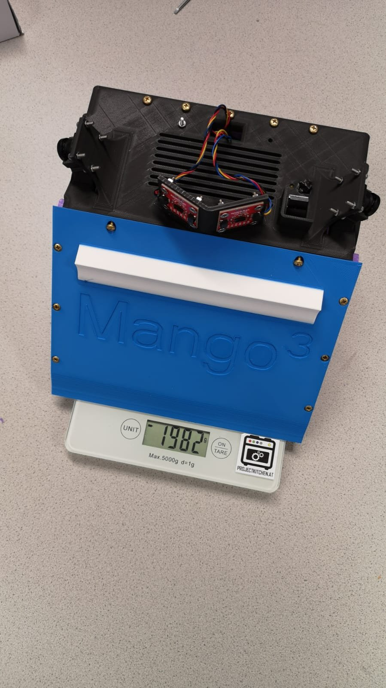
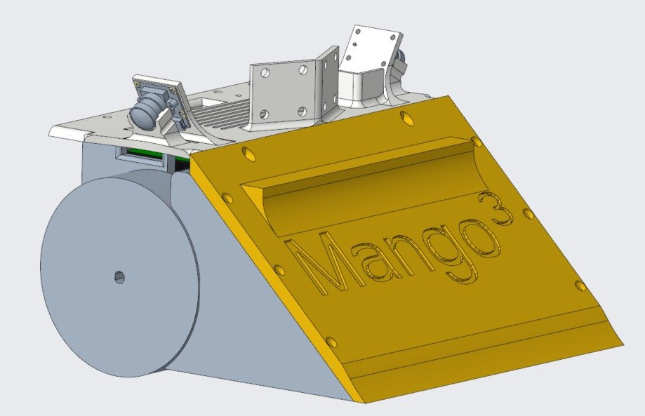
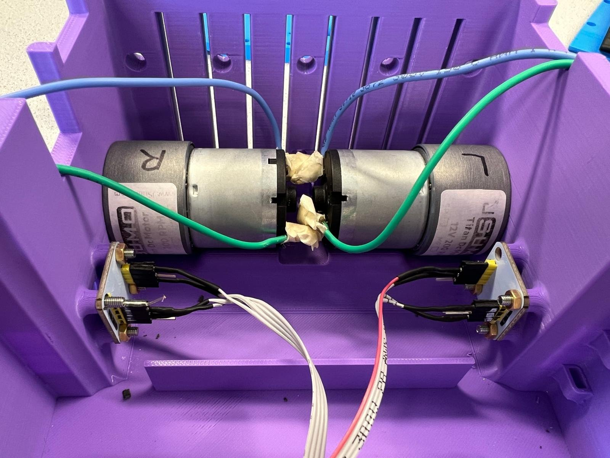
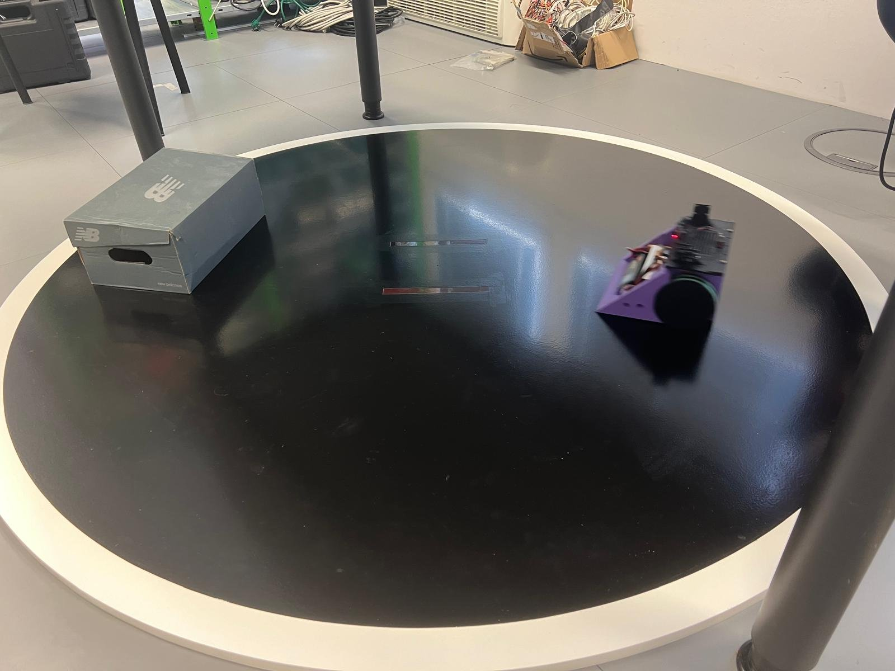
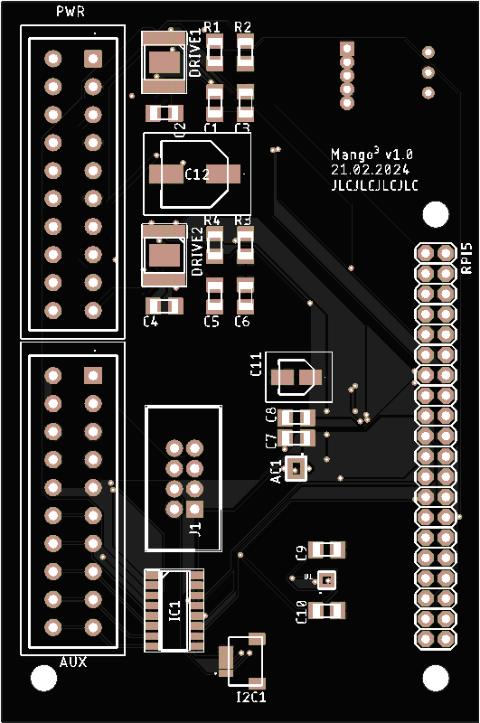
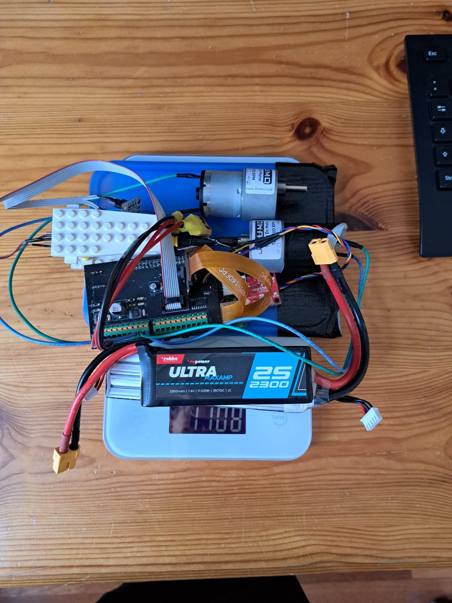
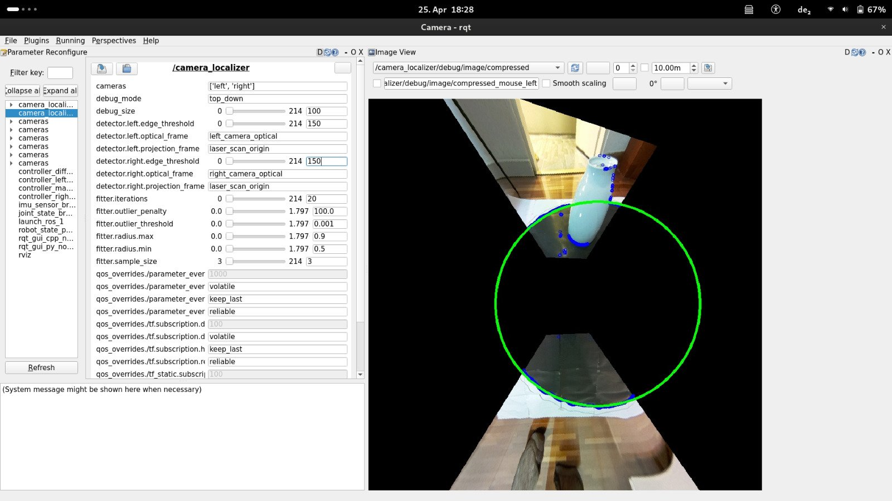

# Mango³ – Autonomous Robot for RoboRingout 2024

**3rd place** at [RoboRingout 2024](https://www.roboringout.at), an inter-university robot competition held at UAS Technikum Wien (Vienna) on 17 May 2024.

In RoboRingout, two fully autonomous robots fight in a circular arena. The goal is to push the opponent out of the arena. Weapons are not allowed, so the contest is decided by strategy, traction and control. Each robot has to fit within a 200 × 200 mm footprint and weigh no more than 2 kg.

Mango³ was built over eight months (Sep 2023 – May 2024) by a team of five students. It follows the team's earlier robots *Mango* and *Mango²*.

  
  

## My role: team lead and electronics

I was the **team lead** and responsible for the **electronics**:

- **Custom PCB:** designed the Raspberry Pi 5 carrier board "Mango³ v1.0" in Autodesk **Eagle**, covering the schematic, the 2-layer layout and the manufacturing data.
- **Assembly and commissioning:** sourced all components, then soldered, tested and integrated the board into the robot.
- **Wiring:** power distribution and the isolating main switch required by the rulebook, which switches both battery circuits without connecting their potentials.
- **Mechanical parts in PTC Creo:** roof, camera mount, Pi standoffs, front wedge, and the 93 mm wheels with a captive-nut shaft lock.
- **Organisation:** team registration, budget, and sponsoring of motors and batteries by industry partners.

## The robot

| | |
|---|---|
| **Controller** | Raspberry Pi 5 |
| **Drive** | Differential drive with 2 × Crouzet DC gear motors, hall-sensor encoders, and PID speed control per wheel |
| **Sensors** | 2 × wide-angle cameras (160°) for localisation in the arena, forward-facing ToF distance sensors (I²C) to detect the opponent, IMU |
| **Power** | 2S LiPo (7.4 V) for logic and 5S LiPo (18.5 V) for the motors, with an isolating main switch for both circuits |
| **Chassis** | Fully 3D-printed in PLA: base, front wedge, roof and wheels with rubber traction bands |
| **Weight** | 1982 g, just under the 2 kg limit |

  
  

## PCB: Mango³ v1.0

A 2-layer FR-4 carrier board that sits on the 40-pin header of the Raspberry Pi 5 and connects all subsystems of the robot:

- **Motor drivers:** 2 × **TI DRV8874** H-bridges (PH/EN mode) with current sensing (IPROPI).
- **Analogue inputs:** **MCP3008** 8-channel ADC on SPI, reading motor currents, encoder signals and spare analogue inputs.
- **Power supply:** DC/DC converter from the 7.4 V battery to 5.1 V for the Raspberry Pi, adjustable with a trimmer.
- **Sensors:** IMU footprint plus a Qwiic/I²C connector for external sensors. A second I²C bus was later brought out for the ToF sensors, which have a fixed address.
- **Connectors:** 2 × 20-pin connectors for power, motors and encoders, a breakout header for spare GPIOs and analogue inputs, and bulk and decoupling capacitors.

The board was designed in February 2024 and manufactured by JLCPCB. After a few fixes (taller pin headers, re-soldering) it ran for the whole season. A second revision was planned but skipped for time and budget reasons.

**Lessons learned:**
- Plan for sensors with fixed I²C addresses from the start, for example with an I²C multiplexer or a second bus on the board.
- Leave headroom on the input voltage of the regulator: it accepts about 13 V, so it cannot be fed from the 5S motor pack.

 

| File | Content |
|---|---|
| [`pcb/schematic/schematic_draft_v1.pdf`](pcb/schematic/schematic_draft_v1.pdf) | Schematic (first draft, 19 Feb 2024). The final robot used a different IMU breakout than the one in this draft. |
| [`pcb/gerber/`](pcb/gerber) | Gerber and drill files as sent to the manufacturer (21 Feb 2024) |

  

## Software (team)

- Camera-based localisation: the arena edge is detected and fitted with a circle to estimate the robot's position.
- A state machine runs the match logic.
- PID speed control on both wheels.
- The CAD model was exported to URDF for simulation.

  

The team's source code is kept in a separate repository and is not part of this repo.

## CAD

[`cad/finalPrint/`](cad/finalPrint) contains the STL files of the final printed parts: base, front wedge and roof.

## Timeline

| Date | Milestone |
|---|---|
| Sep 2023 | Team registered |
| Dec 2023 | Concept kick-off |
| Jan 2024 | Sponsoring of motors and batteries |
| Feb 2024 | PCB designed and ordered |
| Mar 2024 | PCB assembled, first drive tests |
| Apr 2024 | Mechanical integration |
| 10 May 2024 | First full test in the original arena |
| **17 May 2024** | **Competition: 3rd place** |
